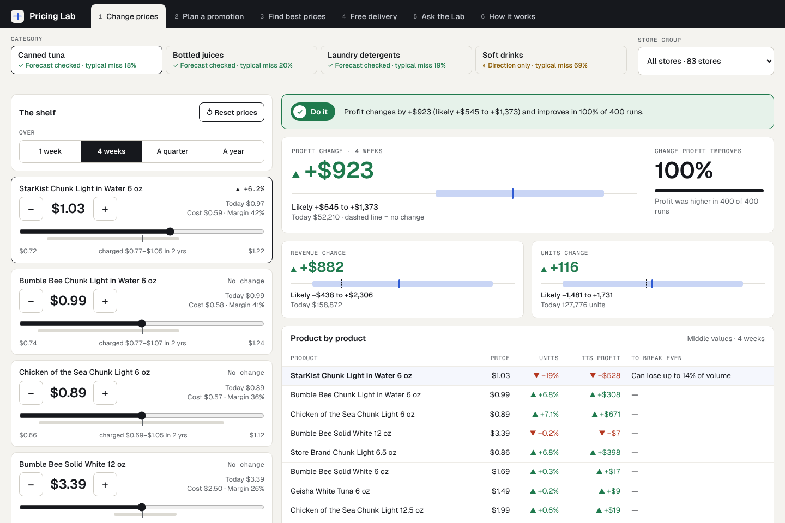
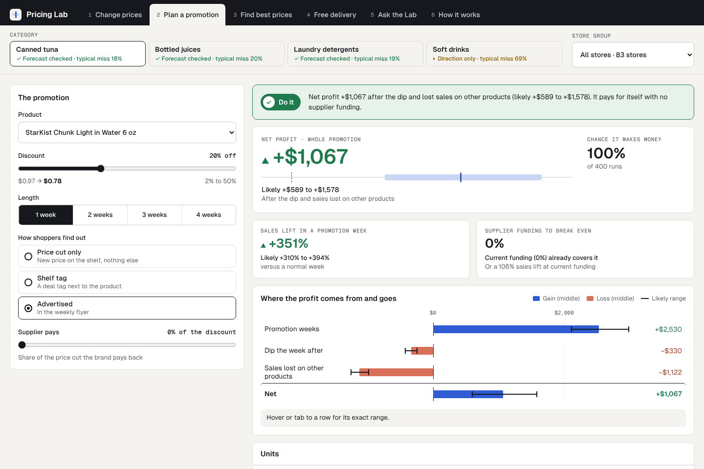
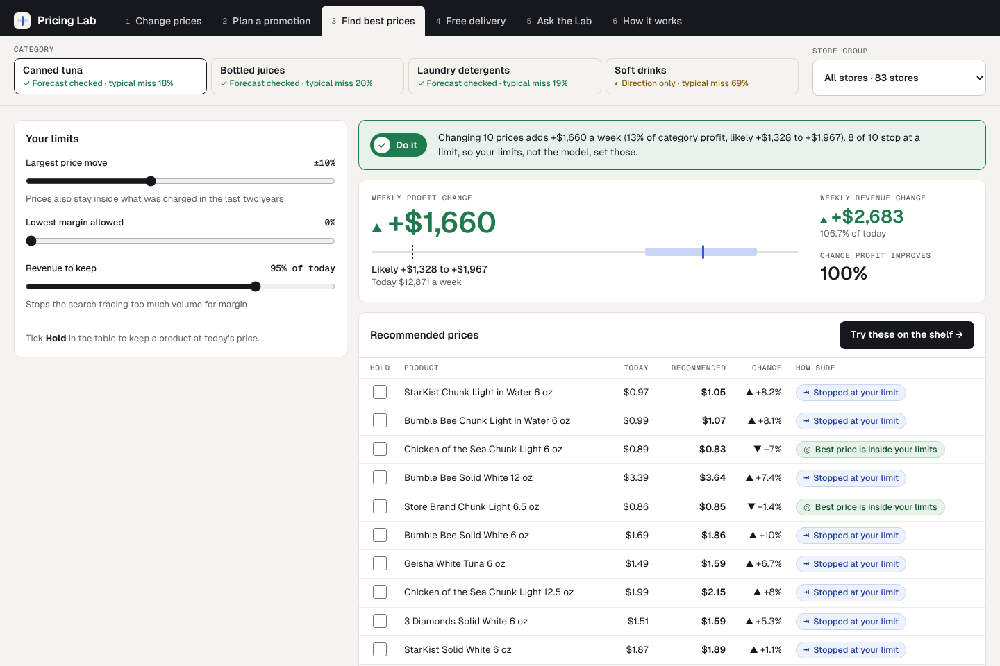
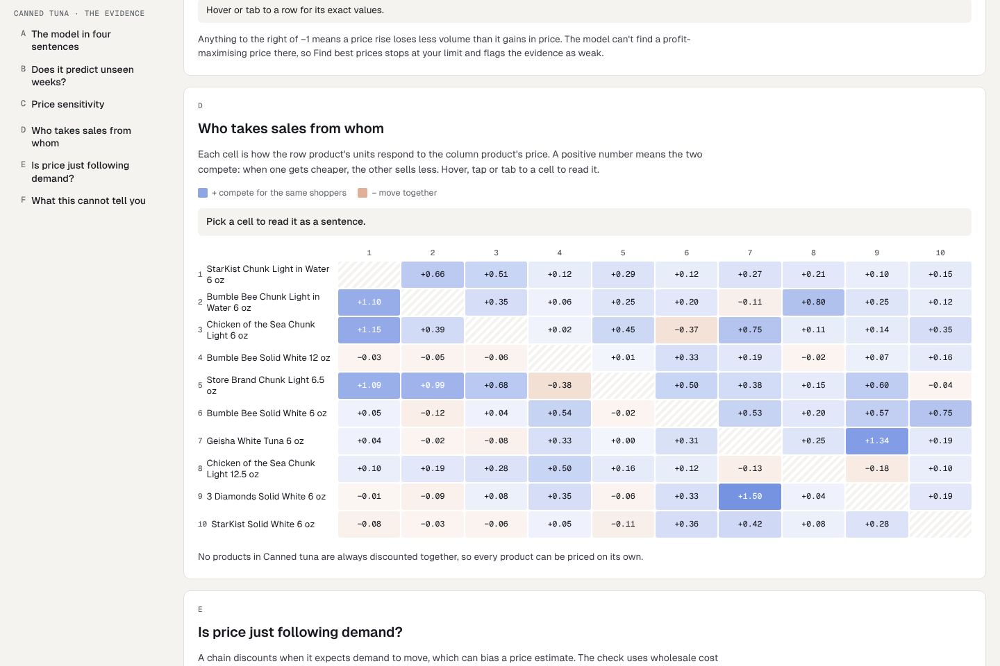
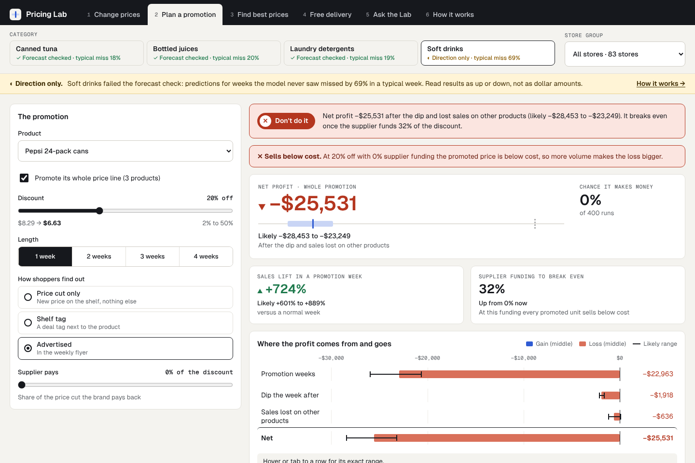

# Pricing Lab

**What should a grocery shelf cost?** Pricing Lab estimates how shoppers respond to price from
eight years of real scanner data, then answers three questions with the uncertainty shown:

- What happens if I change these prices?
- Should I run this promotion?
- What are the best prices inside my limits?

**Live demo:** https://YOUR-APP.vercel.app



## Why it is different

- **Every answer is a range.** Results are computed across 400 posterior draws of the demand
  model and shown as a middle value with a 10th to 90th percentile range.
- **It says when not to trust itself.** Each category carries its out-of-sample forecast error.
  Soft drinks fails validation and is labelled "direction only" on every screen.
- **Recommendations stay inside the evidence.** The optimizer never proposes a price outside
  what was actually charged in the last two years, and flags prices where the data is weak.
- **The assistant cannot invent a number.** It can only call the simulation engine, and every
  number it writes is traced back to an engine result.

## What it found

| Category | Regular-price elasticity | Promotion elasticity | Advertised deal adds | Typical forecast miss (naive benchmark) |
| --- | --- | --- | --- | --- |
| Canned tuna | -3.4 | -3.8 | +103% | 18% (23%) |
| Bottled juices | -1.9 | -2.4 | +72% | 20% (37%) |
| Laundry detergents | -1.4 | -2.7 | +96% | 19% (58%) |
| Soft drinks | -2.1 | -3.1 | +54% | 69% (180%): fails |

- **One elasticity per product is wrong twice.** Shoppers respond to a temporary deal about
  twice as strongly as to a permanent price change in detergent (-2.7 vs -1.4).
- **No 20%-off detergent promotion makes money without supplier funding.** The median
  break-even is the supplier paying 37% of the discount.
- **Within a plus or minus 10% price band,** model-estimated category profit rises 13% in tuna
  and 9% in juice. Most recommended prices stop at the band, so the band, not the model, sets
  them.
- **Soft drinks cannot be modelled this way.** A 24-pack sells about 2,000 units a week at
  regular price and 80,000 on any promotion. A smooth demand curve does not fit an on/off
  product, so the app says so instead of pretending.

Elasticities are category medians after pooling. Profit figures are model estimates on
historical data, not results of a live test.

## The app

| Plan a promotion | Find best prices |
| --- | --- |
|  |  |
| Lift, the dip the week after, sales lost on other products, and the supplier funding needed to break even. | Recommended prices within your limits, each labelled by how far the evidence supports it. |

| How it works | When the model should not be trusted |
| --- | --- |
|  |  |
| Holdout validation, pooled versus raw estimates, cross-price effects and an endogeneity check. | Soft drinks misses by 69% in a typical holdout week, so every screen says "direction only". |

Six sections: Change prices, Plan a promotion, Find best prices, Free delivery (an
assumption-driven calculator, clearly marked as not estimated from data), Ask the Lab, and
How it works. Works on phone and desktop.

## Method

1. **Data.** Dominick's Finer Foods, 93 Chicago-area stores, 399 weeks (1989 to 1997).
   19.3M rows after cleaning across four categories; every dropped row is counted and the
   counts reconcile to the raw total.
2. **Demand model.** One log-log regression per product on 961,285 product-store-weeks:
   regular price, discount depth, an on-promotion step, deal type, a post-promotion dip, and
   the prices of the nine competing products. Standard errors are clustered by week because
   prices are set chain-wide.
3. **Hierarchical Bayes.** A second stage treats each estimate as a noisy measurement and
   pools products within a category (NumPyro, NUTS). Precise estimates barely move;
   implausible ones are pulled toward the category. Worst R-hat 1.017, zero divergences.
4. **Endogeneity check.** Price instrumented with wholesale cost. The instrument is strong
   for only 14 of 40 products, so the simulator uses the plain estimates and the app reports
   where that probably understates price sensitivity.
5. **Validation.** The last 26 weeks are held out, the model is refitted, and predictions are
   compared with what sold and with a naive benchmark.
6. **Simulation.** Price scenarios, promotions and a constrained optimizer run on all 400
   posterior draws. The browser engine is a TypeScript port of the Python reference engine,
   tested to reproduce it to 1e-6.

Full detail, including what did not work: [docs/METHODS.md](docs/METHODS.md).

## Architecture

```
src/pricinglab/     Python: cleaning, demand models, Bayesian pooling, validation, engine
  ingest.py         raw CSVs -> clean panel, with a row audit
  features.py       regular price, discount depth, deal type, post-promo lag, competitor prices
  demand.py         stage 1: regressions per product (pooled, by store, instrumented)
  hierarchy.py      stage 2: hierarchical Bayes, category > product > store
  validate.py       26-week out-of-time holdout
  engine.py         reference simulator: price scenarios, promotions, optimizer
  pipeline.py       fits everything and writes web/public/data/*.json
tests/              60 tests: planted-parameter recovery, hand-calculated engine results
web/                Next.js app
  src/engine/       the simulator in TypeScript, parity-tested against Python
  src/agent/        tool-calling assistant, number tracing, usage limits
  src/ui/           screen logic, and markup generated from the design export
  app/api/ask/      server route that runs the assistant
  evals/            evaluation suite for the assistant
```

The model is fitted offline. The site ships only fitted parameters, so every simulation runs
in the browser with no backend. The one server route is the assistant.

## The assistant

- The language model can call three tools (price change, promotion, optimizer) and nothing
  else. The tools run the same engine as the rest of the app.
- An answer that did not run a tool is discarded and replaced by a fixed refusal, so it
  cannot be used as a general chatbot.
- Every number in an answer is matched against the tool results; anything untraceable is
  flagged on screen.
- Server-side limits: 400-character questions, 6 a minute and 40 a day per visitor, and a
  daily budget for the whole site.
- `npm run evals` scores 26 questions on tool choice, arguments and numeric faithfulness.

## Run it locally

Web app (the fitted model files are included, so this is all you need):

```bash
cd web
npm install
npm test          # 61 tests, including parity with the Python engine
npm run dev       # http://localhost:3000
```

For the assistant, copy `web/.env.example` to `web/.env.local` and add a Groq API key.

Refit the models (needs the Dominick's files from the Kilts Center in `data/raw/`):

```bash
python -m venv .venv
.venv/Scripts/python -m pip install -e ".[dev]"     # macOS/Linux: .venv/bin/python
.venv/Scripts/python -m pytest                      # 60 tests
.venv/Scripts/python -m pricinglab.ingest
.venv/Scripts/python -m pricinglab.pipeline         # rewrites web/public/data
```

## Limits

- 1990s prices from one chain. The method transfers; the numbers do not.
- Category view only: basket and store-traffic effects are not modelled.
- Weeks with zero sales are missing from the data, so stock-outs are invisible.
- "Chance profit improves" reflects uncertainty in the estimated coefficients, not the
  possibility that the model form is wrong.

## Data and licence

Data: James M. Kilts Center, University of Chicago Booth School of Business
([Dominick's dataset](https://www.chicagobooth.edu/research/kilts/research-data/dominicks)),
for academic research use. This repository contains fitted model parameters and chain-level
aggregates only, never store records.

Code: MIT. Built by Mohit Luthra.
